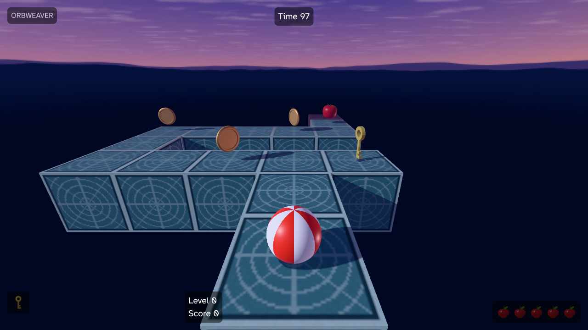

# Orbweaver



A small ball-rolling puzzle game on the [rocco](https://github.com/Pixelsprout/rocco-engine)
engine, built for the web.

A ball rolls over floating blocks at dusk. When the ball rolls over an edge,
gravity turns with it, so every face of a block is floor. Collect every key,
then roll onto the exit. Three short levels teach the moves one at a time:

| Level | Teaches |
|---|---|
| 1 | Rolling and turning, on one flat layer |
| 2 | The gravity turn: roll over the end of a bar and along its underside |
| 3 | The jump, then all three moves together |

## Controls

| Input | Action |
|---|---|
| Up, held | Roll forward, one cell after another |
| Left / Right | Turn 90° |
| Space | Jump in place |
| Up and Space | Jump forward two cells |
| Space, after a level | Go on to the next level |
| Enter, after the last level | Play again from level 1 |
| Escape | Quit |

The controls turn the ball, not the screen. A native build also reads a
gamepad: the D-pad or left stick rolls and turns, South jumps and Start quits.
A web build has no gamepad.

## Run

Orbweaver needs Roc `nightly-2026-11-04-2622062`. Roc downloads the rocco
v0.14.1 bundles named in the `main.roc` header. From this directory:

```sh
roc main.roc
roc test main.roc
```

## Web build

The web build needs Roc and Python 3. From this directory:

```sh
curl -LO https://github.com/Pixelsprout/rocco-engine/releases/download/v0.14.1/rocco_web.py
python3 rocco_web.py
```

The build writes `build/web/` and a zip. Serve the folder from `localhost`, because
WebGPU needs a secure context:

```sh
python3 -m http.server 8000 --bind 127.0.0.1 --directory build/web
```

`web/index.html` is the page. It shows only the canvas on a dark background
and starts the game when it loads. A page that embeds it in an iframe
supplies its own poster and buttons, and loads the iframe after a click, so
audio can start. Escape quits. The engine then sends `rocco:quit` on the
iframe's `window`, and the host page can reload the iframe.

## Rules

- **Roll.** A block ahead: the ball climbs onto its face. A block ahead and
  one down: the ball rolls one cell. No block ahead: the ball rolls over the
  edge onto the side of its block, and gravity turns. An edge roll needs an
  open end: no block to the left or right of the block the ball stands on.
- **Turn.** Left and Right turn the ball 90° in place.
- **Jump.** A forward jump aims two cells ahead at the same level. With no
  block under the landing cell, the ball falls. A block in the way bounces it
  back.
- **Fall.** A fall restarts the level and costs points.
- **Keys and exit.** The exit opens when every key of the level is
  collected. The ball reaches it by rolling or jumping onto it.
- **Score.** A key is 1000, a coin 250 and a fruit 2500. The level end adds
  the level score to the total.
- **Clock.** Each level starts at 99 s. At 0 the level restarts. In the
  last 20 s a tick plays each second.
- **Fruit.** Five fruits come in order: apple, watermelon, pumpkin, banana
  and strawberry. The panel at the bottom right lights each one collected.

## Level files

A level is a text file in `levels/`. It holds layers of the grid, bottom
layer first, with a blank line between layers. The layer index is `y`, the
row is `z` and the column is `x`. Every row has the same length.

| Character | Meaning |
|---|---|
| `.` | Empty |
| `#` | A block |
| `S` | A block. The ball starts on top of it, facing `-z`. |
| `K` | A block with a key on top |
| `E` | The exit block |

A line with a space is an entry, which puts an item or the start on any face
of a block:

| Entry | Meaning |
|---|---|
| `x y z face item` | Item `key`, `coin`, `fruit` or `exit` on face `face` of the block at `x y z` |
| `start x y z face forward` | The ball starts on face `face` of the block at `x y z`, facing `forward` |
| `time n` | The clock starts at `n` seconds. Without it, the clock starts at 99 s |

A face or a forward is `+x`, `-x`, `+y`, `-y`, `+z` or `-z`. The forward
must be at right angles to the face. A level needs exactly one start.

## Look

The one Theme, `gloam`, is a dusk after sunset. The sky is deep blue at the
top with stars and rose near the horizon, with a pale moon and two ridges of
hills. A cool moonlight lights the blocks from low in the `-x` sky, and a
warm fill comes from the other side. The block faces are teal slate with a
pale rim and a faint web of spokes and rings. Far faces fade into a dark
blue fog.

The key is pale brass and 0.5 tall: a ring bow, a round shaft and two teeth.
The coin is bronze and 0.4 wide, with a raised rim.

Scripts in `assets/source/` make every asset. Commit the scripts and their
outputs. The game build does not run them.

| Script | Makes | Needs |
|---|---|---|
| `make_meshes.py` | `assets/meshes/`: the block face, the ball, the coin, the key and the fruits | Blender |
| `make_skies.py` | `assets/sky/gloam/`: six 512 × 512 cube faces. It prints the horizon colour that `Theme.roc` uses for the fog | Python 3 with numpy |
| `make_sounds.py` | `assets/sound/`: the bounce, chime, tick, jingle and key sounds | Python 3 |
| `make_icons.py` | `assets/images/`: the HUD key and fruit icons | Python 3 |

```sh
/Applications/Blender.app/Contents/MacOS/Blender --background --python assets/source/make_meshes.py
/Applications/Blender.app/Contents/Resources/5.2/python/bin/python3.13 assets/source/make_skies.py
python3 assets/source/make_sounds.py
python3 assets/source/make_icons.py
```

## Code

| File | Holds |
|---|---|
| `main.roc` | The app: `launch`, `init`, `loaded`, `step` and `view` |
| `Rules.roc` | Phases, pickups, the exit, falls and restarts |
| `Ball.roc` | Rolls, turns, jumps, falls and bounces |
| `Level.roc` | The level file parser |
| `Theme.roc` | The look: lights, sky and fog |
| `View.roc` | The camera and the block faces |
| `Hud.roc` | The panels: name, time, keys, scores and fruit |
| `Pickup.roc`, `Fruit.roc`, `Score.roc`, `Clock.roc`, `Flash.roc`, `Ending.roc` | Items, scores, the clock, the pickup light and the level end |

## License

See `LICENSE`.
